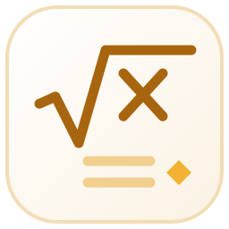
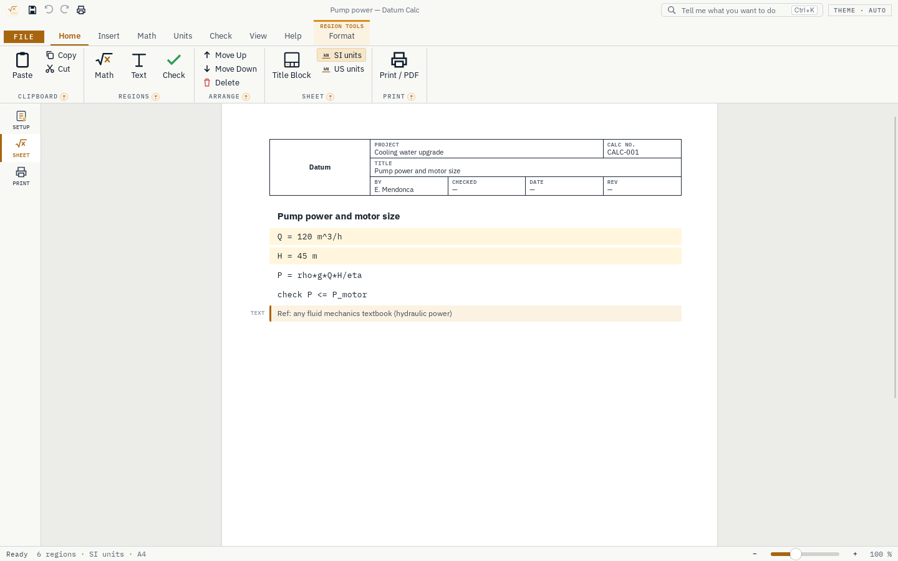

<div align="center">



# Datum Calc

**Engineering calculations with real units, as readable maths, with checks and a printable calc sheet.**

[](https://github.com/Edgar-Mendonca/Datum-Calc/releases/latest)
[](https://github.com/Edgar-Mendonca/Datum-Calc/actions/workflows/ci.yml)
[](https://github.com/Edgar-Mendonca/Datum-Calc/releases)
[](LICENSE)
[](https://github.com/Edgar-Mendonca/Datum-Calc/releases/latest)
[](crates/core)
[](https://tauri.app)
[](ui/src)

[](https://github.com/Edgar-Mendonca/Datum-Calc/releases/latest)
[](CHANGELOG.md)
[](https://github.com/Edgar-Mendonca/Datum-Calc/issues/new)
[](docs/MEMORY.md)

</div>



## What it does

Datum Calc is a desktop app for engineering calculation sheets. You write the calculation top to bottom, as on paper: an equation per line with its units, text for headings and references, and checks against your limits. It prints as a clean calc sheet with a title block and page numbers, ready to hand in.

1. **Write the equations.** `Q = 120 m^3/h`, `H = 45 m`, `P = rho*g*Q*H/eta`. Greek letters and subscripts are typed simply (`sigma_allow`).
2. **Check the results.** Every answer carries its unit, and `check sigma <= sigma_allow` shows PASS or FAIL with the utilisation ratio.
3. **Print the calc sheet.** Fill in the title block (project, calc number, by, checked, date, revision) and save a PDF.

It is for mechanical, process, structural and electrical engineers, students and lecturers: everyone who writes calculations. It is part of the [Datum family](https://edgar-mendonca.github.io/Datum/) of free, open-source desktop tools for engineers and scientists; its page on the family site is [edgar-mendonca.github.io/Datum/apps/calc](https://edgar-mendonca.github.io/Datum/apps/calc).

## Where it is going

| Version | What |
| --- | --- |
| 0.1.0 | The window, the calc sheet with its title block, saving and opening, printing, the updater |
| 0.1.1 | The engine: units, equations, results and checks worked out; maths shown as you would write it |
| 0.1.2 | Solve, plot and table regions; print to PDF |
| 0.1.3 | Ten ready calc packs (pumps, pipes, compressors, heat exchangers, vessels, beams, bolts, motors) |
| 0.2 – 1.0 | Materials from Datum Atlas, matrices and ODEs, templates, a validation report |

File › Roadmap in the app shows the full list; it comes from [`docs/site.json`](docs/site.json).

## Install

Download `DatumCalc-x.y.z-setup.exe` from the [latest release](https://github.com/Edgar-Mendonca/Datum-Calc/releases/latest) and run it. It installs for your user only, in seconds, and updates itself from File › Updates. Each release has a `SHA256SUMS.txt` to check the download. Datum Home (from the family site) can install and update it too.

Free and open source (MIT). Windows first. No accounts, no telemetry: your files stay on your computer, and the only network call is the update check.

## Build from source

```bash
npm ci
npm run build:ui
cargo test --workspace
npx tauri build --bundles nsis
```

See [CONTRIBUTING.md](CONTRIBUTING.md) for the checks, and [docs/MEMORY.md](docs/MEMORY.md) for the architecture and decisions.
