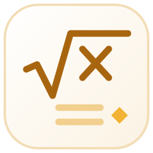
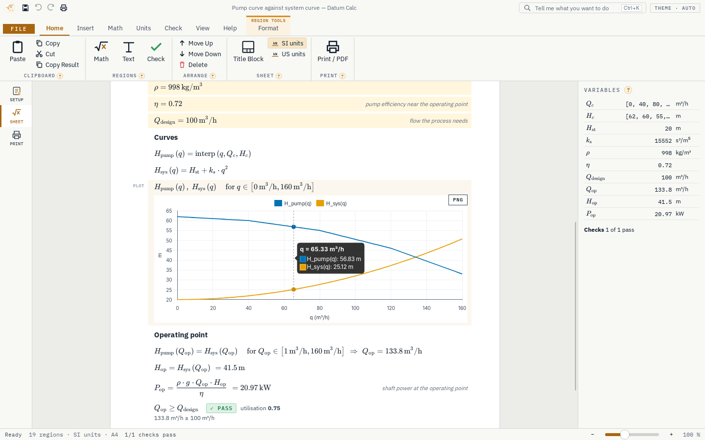
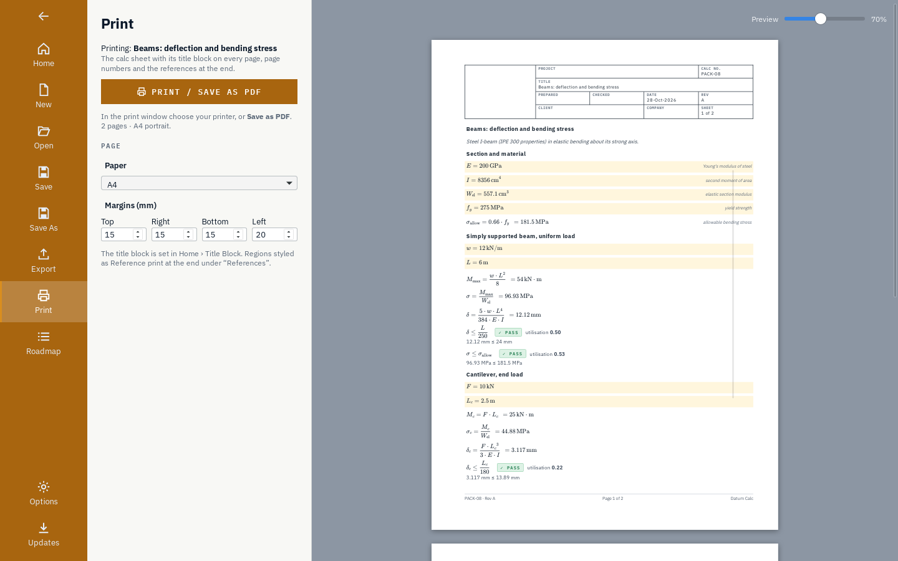
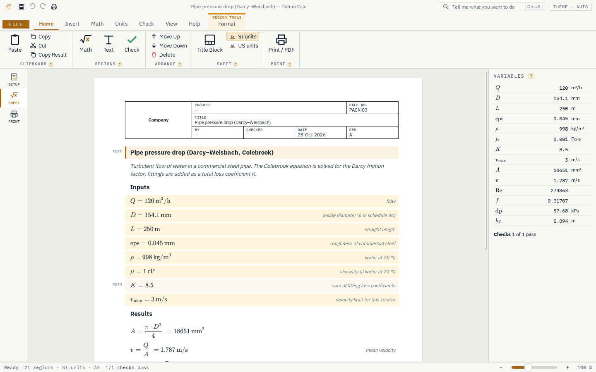

<div align="center">



# Datum Calc

**Engineering calculations with real units, as readable maths, with checks and a printable calc sheet.**

[](https://github.com/Edgar-Mendonca/Datum-Calc/releases/latest)
[](https://github.com/Edgar-Mendonca/Datum-Calc/actions/workflows/ci.yml)
[](https://github.com/Edgar-Mendonca/Datum-Calc/releases)
[](LICENSE)
[](https://github.com/Edgar-Mendonca/Datum-Calc/releases/latest)
[](crates/core)
[](https://tauri.app)
[](ui/src)

[](https://github.com/Edgar-Mendonca/Datum-Calc/releases/latest)
[](CHANGELOG.md)
[](https://github.com/Edgar-Mendonca/Datum-Calc/issues/new)
[](docs/MEMORY.md)

</div>



## What it does

Datum Calc is a desktop app for engineering calculation sheets. You write the calculation top to bottom, as on paper: an equation per line with its units, text for headings and references, and checks against your limits. It prints as a clean calc sheet with a title block and page numbers, ready to hand in.

1. **Write the equations.** `Q = 120 m^3/h`, `H = 45 m`, `P = rho*g*Q*H/eta`. Greek letters and subscripts are typed simply (`sigma_allow`).
2. **Check the results.** Every answer carries its unit (a torque in N·m, an AC current as a complex phasor such as (12.04 − 3.346j) A or 12.5 A∠−15.53°, ω = 2πf in rad/s; any result in any unit of its kind), and `check sigma <= sigma_allow` shows PASS or FAIL with the utilisation ratio.
3. **Show the numbers.** View › Numbers repeats each equation with its values put in, as on a hand calculation.
4. **Print the calc sheet.** Fill in the title block (project, calc number, by, checked, date, revision) and save a PDF.

**Twenty calc packs** start you off (File › New from pack), each with its inputs at the top, its results and checks below and its references at the end, and each checked against a hand calculation in the tests:

| Rotating equipment | Process | Mechanical | Electrical |
| --- | --- | --- | --- |
| Pump power, efficiency and motor size · NPSH available against required · Pump curve against system curve (operating point) · Compressor polytropic head and power · Shaft torsion | Pipe pressure drop (Darcy–Weisbach, Colebrook) · Heat exchanger duty and LMTD · Tank volume and fill time · Pipe wall thickness · Heat loss from an insulated pipe | Thin-walled pressure vessel · Beams: deflection and bending stress · Bolt preload and tightening torque · Thermal expansion of a pipe · Column buckling (Euler) · Fillet weld in shear | Electric motor: current, power factor and starting current · Cable voltage drop · AC circuit: impedance, current and power factor · RC low-pass filter: Bode plots |

<table><tr>
<td width="50%"><br><sub>The printed calc sheet: title block, maths, results, PASS/FAIL checks, page numbers.</sub></td>
<td width="50%"><br><sub>Inputs with units and descriptions; every name, value and unit in the Variables panel.</sub></td>
</tr></table>

It is for mechanical, process, structural and electrical engineers, students and lecturers: everyone who writes calculations. It is part of the [Datum family](https://edgar-mendonca.github.io/Datum/) of free, open-source desktop tools for engineers and scientists; its page on the family site is [edgar-mendonca.github.io/Datum/apps/calc](https://edgar-mendonca.github.io/Datum/apps/calc).

## Where it is going

| Version | What |
| --- | --- |
| 0.1.0 – 0.1.11 ✅ | The calc sheet and its printing with a summary of checks; units, equations, checks, solve and plot; tables and pictures; twenty calc packs; equations with their numbers; complex numbers for AC circuits, phasors and Bode plots; a Getting Started sheet; recovery per window; Save changes? before a sheet is replaced; hardening |
| 0.1.12 | Fixes from trying every pack on a clean Windows PC and from the convention |
| 0.2 | Materials from Datum Atlas, more packs |
| 0.3 – 1.0 | Matrices and ODEs, templates, a validation report, a signed installer |

File › Roadmap in the app shows the full list; it comes from [`docs/site.json`](docs/site.json).

## Install

Download `DatumCalc-x.y.z-setup.exe` from the [latest release](https://github.com/Edgar-Mendonca/Datum-Calc/releases/latest) and run it. It installs for your user only, in seconds, and updates itself from File › Updates. Each release has a `SHA256SUMS.txt` to check the download. Datum Home (from the family site) can install and update it too.

Free and open source (MIT). Windows first. No accounts, no telemetry: your files stay on your computer, and the only network call is the update check.

## Build from source

```bash
npm ci
npm run build:ui
cargo test --workspace
npx tauri build --bundles nsis
```


## Part of the Datum family

Free, open-source desktop tools for engineers, scientists, researchers and analysts: [edgar-mendonca.github.io/Datum](https://edgar-mendonca.github.io/Datum). MIT licence; see [NOTICE](NOTICE) for third-party code and data.


## The apps

| | App | What it is for | Latest | |
| :---: | --- | --- | --- | --- |
|  | **[Datum Plan](https://edgar-mendonca.github.io/Datum/apps/plan)** | Plan, schedule, track and report projects. For project managers, planners, engineers and contractors. | [](https://github.com/Edgar-Mendonca/Datum-Plan/releases/latest) | [Download](https://github.com/Edgar-Mendonca/Datum-Plan/releases/latest) · [Repo](https://github.com/Edgar-Mendonca/Datum-Plan) |
|  | **[Datum Plot](https://edgar-mendonca.github.io/Datum/apps/plot)** | Analyse data and make publication-ready graphs. For scientists, researchers, lab teams and students. | [](https://github.com/Edgar-Mendonca/Datum-Plot/releases/latest) | [Download](https://github.com/Edgar-Mendonca/Datum-Plot/releases/latest) · [Repo](https://github.com/Edgar-Mendonca/Datum-Plot) |
|  | **[Datum Atlas](https://edgar-mendonca.github.io/Datum/apps/atlas)** | Choose materials with property charts and selection indices. For design and materials engineers, and students. | [](https://github.com/Edgar-Mendonca/Datum-Atlas/releases/latest) | [Download](https://github.com/Edgar-Mendonca/Datum-Atlas/releases/latest) · [Repo](https://github.com/Edgar-Mendonca/Datum-Atlas) |
|  | **[Datum Sim](https://edgar-mendonca.github.io/Datum/apps/sim)** | Model and simulate dynamic systems: block diagrams, control and motors. For control, mechanical, electrical, process and mechatronics engineers. | [](https://github.com/Edgar-Mendonca/Datum-Sim/releases/latest) | [Download](https://github.com/Edgar-Mendonca/Datum-Sim/releases/latest) · [Repo](https://github.com/Edgar-Mendonca/Datum-Sim) |
|  | **[Datum Calc](https://edgar-mendonca.github.io/Datum/apps/calc)** | Engineering calculations with real units, readable maths, checks and a printable calc sheet. For every engineer who writes calculations. | [](https://github.com/Edgar-Mendonca/Datum-Calc/releases/latest) | [Download](https://github.com/Edgar-Mendonca/Datum-Calc/releases/latest) · [Repo](https://github.com/Edgar-Mendonca/Datum-Calc) |
|  | **[Datum Mesh](https://edgar-mendonca.github.io/Datum/apps/mesh)** | Finite-element analysis: stresses, deflections and temperatures in parts and frames, with a verification report. For mechanical, structural and process engineers. | [](https://github.com/Edgar-Mendonca/Datum-Mesh/releases/latest) | [Download](https://github.com/Edgar-Mendonca/Datum-Mesh/releases/latest) · [Repo](https://github.com/Edgar-Mendonca/Datum-Mesh) |
|  | **[Datum Pipe](https://edgar-mendonca.github.io/Datum/apps/pipe)** | Pipe stress analysis: displacements, support and nozzle loads, code stresses and an automatic isometric. For piping, stress and plant engineers. | [](https://github.com/Edgar-Mendonca/Datum-Pipe/releases/latest) | [Download](https://github.com/Edgar-Mendonca/Datum-Pipe/releases/latest) · [Repo](https://github.com/Edgar-Mendonca/Datum-Pipe) |

See [CONTRIBUTING.md](CONTRIBUTING.md) for the checks, and [docs/MEMORY.md](docs/MEMORY.md) for the architecture and decisions.

Product and file-format names are trademarks of their owners and are used only to describe file compatibility.
